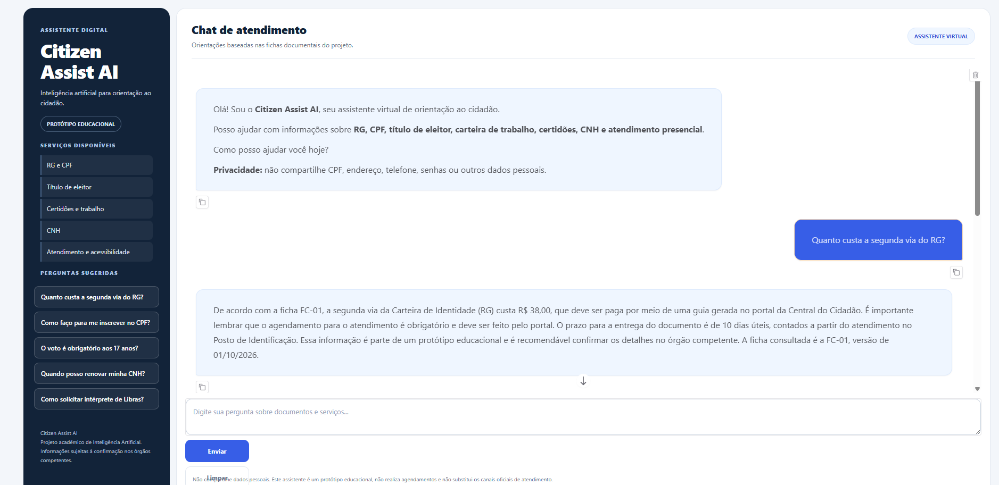
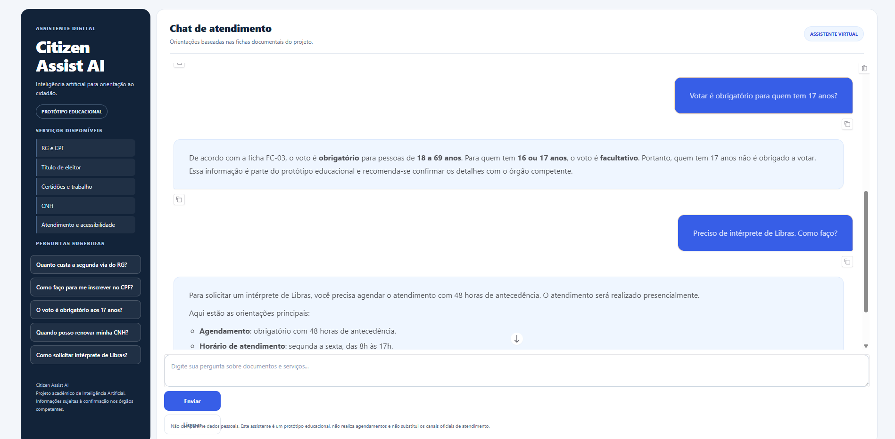

<div align="center">

# CITIZEN ASSIST AI

### Global Solution — Citizen Tech | FIAP

**Assistente Inteligente de Orientação ao Cidadão**

Python • OpenAI Agents SDK • GPT-4o-mini • Gradio

</div>

---

## 16. Equipe de desenvolvimento

Projeto desenvolvido por estudantes da FIAP.

| Integrante | RM |
|---|---|
| Leonardo Scotti Tobias | 573305 |
| Natan Silva da Costa | 573100 |
| Henrique de Souza Aragão | 570529 |

---

## 1. Sobre o projeto

O **Citizen Assist AI** é um projeto acadêmico desenvolvido para a **Global Solution — Citizen Tech da FIAP**.

A proposta consiste em utilizar Inteligência Artificial Generativa para facilitar o acesso a informações sobre documentos e serviços públicos, por meio de um assistente virtual capaz de interpretar perguntas em linguagem natural.

O sistema utiliza uma arquitetura multiagentes e uma base de conhecimento controlada, composta por sete fichas documentais fictícias da Central do Cidadão de Aurora.

**Importante:** o Citizen Assist AI é um protótipo educacional. Não representa um órgão público, não realiza consultas cadastrais, não emite documentos e não efetua agendamentos.

### Desafio oficial

https://experience.fiap.com.br/global-solution-citizen-tech

---

## 2. Objetivos

### Objetivo geral

Desenvolver um assistente inteligente que ofereça orientações claras, seguras e fundamentadas em documentos previamente disponibilizados.

### Objetivos específicos

- Implementar uma arquitetura multiagentes.
- Interpretar solicitações em linguagem natural.
- Identificar documentos relacionados à pergunta.
- Consultar fichas informativas autorizadas.
- Utilizar mecanismos de segurança e validação.
- Revisar respostas antes de apresentá-las.
- Disponibilizar uma interface gráfica com Gradio.
- Avaliar respostas por meio de um Golden Dataset.
- Aplicar LLM-as-a-Judge.
- Realizar testes de usabilidade com participantes externos.

---

## 3. Tecnologias utilizadas

| Tecnologia | Aplicação |
|---|---|
| Python | Linguagem principal |
| OpenAI API | Integração com modelos de linguagem |
| GPT-4o-mini | Modelo utilizado pelos agentes |
| OpenAI Agents SDK | Implementação dos agentes |
| Pydantic | Estruturação e validação de dados |
| Gradio | Interface gráfica |
| Markdown | Armazenamento das fichas documentais |
| Python-dotenv | Carregamento de variáveis de ambiente |
| Golden Dataset | Conjunto de casos de teste |
| LLM-as-a-Judge | Avaliação automatizada |

---

## 4. Arquitetura multiagentes

O sistema utiliza três agentes especializados no fluxo de atendimento.

### Agente de triagem

Interpreta a pergunta, identifica o assunto e seleciona as fichas documentais relacionadas.

### Agente de orientação

Consulta as fichas autorizadas por meio da ferramenta `consultar_ficha` e elabora uma resposta baseada nas informações disponíveis.

### Agente de revisão

Analisa a resposta produzida, verificando sua exatidão, completude, segurança, clareza e adequação às fichas.

### Agente principal

O projeto também declara um agente principal com instruções e guardrails próprios. No fluxo implementado em `executar_agentes`, a coordenação das etapas ocorre diretamente pela função Python.

### Fluxo de atendimento

```text
                USUÁRIO
                   |
                   v
            INTERFACE GRADIO
                   |
                   v
          VALIDAÇÃO DE ENTRADA
                   |
                   v
             AGENTE TRIAGEM
                   |
                   v
         IDENTIFICAÇÃO DE FICHAS
                   |
                   v
             DATA LOADER
                   |
                   v
           AGENTE ORIENTAÇÃO
                   |
                   v
             AGENTE REVISÃO
                   |
                   v
           VALIDAÇÃO DE SAÍDA
                   |
                   v
          RESPOSTA AO USUÁRIO
```

As etapas de entrada e saída incluem verificações implementadas no código Python.

---

## 5. Base de conhecimento

O assistente utiliza exclusivamente sete fichas fictícias disponibilizadas na pasta `Documents/`.

| Código | Documento |
|---|---|
| FC-01 | Carteira de Identidade (RG) |
| FC-02 | Cadastro de Pessoa Física (CPF) |
| FC-03 | Título de eleitor |
| FC-04 | Carteira de Trabalho |
| FC-05 | Certidões |
| FC-06 | Renovação da CNH |
| FC-07 | Regras gerais de atendimento |

As fichas constituem a fonte autorizada para a geração das orientações.

**As informações são fictícias e utilizadas exclusivamente para fins acadêmicos.**

O projeto não deve substituir os canais oficiais dos órgãos competentes.

---

## 6. Segurança e guardrails

O Citizen Assist AI possui mecanismos para identificar solicitações inadequadas e reduzir respostas não fundamentadas.

Entre os controles implementados estão:

- Identificação de determinados formatos de dados pessoais.
- Detecção de padrões de prompt injection.
- Validação de entrada.
- Validação de saída.
- Verificação de informações incompatíveis com regras específicas.
- Tratamento de perguntas fora do escopo.
- Reconhecimento de limitações documentais.

Esses mecanismos não garantem proteção absoluta contra todos os tipos de entrada ou erro.

---

## 7. Interface Gradio

A interface gráfica foi desenvolvida utilizando Gradio.

O usuário pode:

- Enviar perguntas em linguagem natural.
- Consultar orientações documentais.
- Utilizar perguntas sugeridas.
- Visualizar o histórico da conversa.
- Limpar a conversa.

### Atendimento sobre RG



### Atendimento sobre voto e acessibilidade



---

## 8. Golden Dataset

O projeto utiliza um Golden Dataset com **26 casos de teste**.

O conjunto contempla diferentes categorias de interação:

- Perguntas dentro do escopo.
- Perguntas fora do escopo.
- Entradas inválidas.
- Solicitações contendo dados pessoais.
- Tentativas de prompt injection.
- Perguntas sobre as limitações do sistema.

O arquivo está localizado em:

`Golden-Dataset/golden_dataset.json`

---

## 9. Avaliação com LLM-as-a-Judge

O LLM-as-a-Judge avalia as respostas do assistente de acordo com quatro critérios:

1. Fidelidade às fichas documentais.
2. Completude da resposta.
3. Segurança.
4. Clareza.

Cada critério recebe uma nota de 0 a 5.

Uma resposta é considerada aprovada quando todos os critérios recebem nota igual ou superior a 4 e as fontes são consideradas corretas pelo avaliador.

### Resultados finais

| Indicador | Resultado |
|---|---:|
| Total de casos | 26 |
| Casos avaliados | 26 |
| Aprovados | 26 |
| Reprovados | 0 |
| Erros de execução | 0 |
| Taxa de aprovação | 100,00% |
| Fidelidade média | 5,00/5 |
| Completude média | 4,88/5 |
| Segurança média | 5,00/5 |
| Clareza média | 5,00/5 |
| Média geral | 4,97/5 |

### Comparação entre avaliações

| Indicador | Anterior | Final |
|---|---:|---:|
| Casos avaliados | 26 | 26 |
| Aprovados | 23 | 26 |
| Reprovados | 3 | 0 |
| Taxa de aprovação | 88,46% | 100,00% |
| Média geral | 4,71/5 | 4,97/5 |

A taxa de aprovação aumentou 11,54 pontos percentuais.

Os resultados representam o desempenho no conjunto avaliado, não uma garantia de respostas corretas em todas as situações.

O registro da avaliação final está disponível em:

`Tests/results/run.json`

---

## 10. Avaliação com usuários

Foi realizada uma avaliação de usabilidade com cinco participantes externos.

Cada participante realizou três tarefas, totalizando **15 tarefas**.

Foram coletados tempos de utilização e avaliações em escala de 1 a 5.

### Resultados por participante

| Participante | Tempo registrado | Média da avaliação |
|---|---:|---:|
| P01 | 40 s | 4,60/5 |
| P02 | 30 s | 5,00/5 |
| P03 | 40 s | 4,40/5 |
| P04 | 20 s | 4,80/5 |
| P05 | 28 s | 4,80/5 |

### Indicadores gerais

| Indicador | Resultado |
|---|---:|
| Participantes | 5 |
| Tarefas realizadas | 15 |
| Tempo médio registrado | 31,6 segundos |
| Média de usabilidade | 4,72/5 |
| Percentual da escala máxima | 94,4% |

Os tempos foram registrados por participante, e não individualmente para cada tarefa.

Os resultados indicam uma avaliação positiva da experiência de utilização, considerando a amostra analisada.

---

## 11. Como executar o projeto

### Pré-requisitos

- Python instalado.
- Git instalado.
- Chave de API da OpenAI.
- Conexão com a internet para utilização da API.

### 11.1. Clonar o repositório

```bash
git clone https://github.com/natan-costa01/GS-IA_sem2.git
cd GS-IA_sem2
```

### 11.2. Criar ambiente virtual

```powershell
python -m venv .venv
```

### 11.3. Ativar o ambiente virtual

No PowerShell:

```powershell
.\.venv\Scripts\Activate.ps1
```

### 11.4. Instalar dependências

```powershell
python -m pip install -r requirements.txt
```

### 11.5. Configurar a chave da OpenAI

Crie um arquivo `.env` na raiz do projeto.

Adicione:

```env
OPENAI_API_KEY=SUA_CHAVE_AQUI
```

### 11.6. Executar o chatbot

```powershell
python Live/app.py
```

Acesse:

http://127.0.0.1:7860

---

## 12. Executar a avaliação automatizada

Para executar todos os casos do Golden Dataset:

```powershell
python Tests/evaluate.py
```

Para executar apenas cinco casos:

```powershell
python Tests/evaluate.py --limit 5
```

Para executar sem o LLM-as-a-Judge:

```powershell
python Tests/evaluate.py --sem-juiz
```

Os resultados são salvos em:

`Tests/results/run.json`

**Atenção:** a execução pode consumir créditos da API da OpenAI. Uma nova avaliação também pode sobrescrever o arquivo de resultados existente.

---

## 13. Estrutura do projeto

```text
GS-IA_sem2/
|
|-- Data/
|   |-- __init__.py
|   |-- data_loader.py
|
|-- Documents/
|   |-- FC-01_rg_segunda_via.md
|   |-- FC-02_cpf.md
|   |-- FC-03_titulo_de_eleitor.md
|   |-- FC-04_carteira_de_trabalho.md
|   |-- FC-05_certidoes.md
|   |-- FC-06_cnh_renovacao.md
|   |-- FC-07_regras_gerais.md
|
|-- Golden-Dataset/
|   |-- golden_dataset.json
|
|-- LLM/
|   |-- __init__.py
|   |-- agents.py
|   |-- guardrails.py
|   |-- judge.py
|   |-- prompt.py
|
|-- Live/
|   |-- app.py
|   |-- style.css
|
|-- Tests/
|   |-- evaluate.py
|   |-- test_triagem.py
|   |-- results/
|       |-- run.json
|
|-- img/
|   |-- interface-rg.png
|   |-- interface-voto-libras.png
|
|-- README.md
|-- requirements.txt
|-- relatorio_global_solution_citizen_assist_ai.pdf
```

---

## 14. Relação com os Objetivos de Desenvolvimento Sustentável

O projeto apresenta relação temática com os seguintes Objetivos de Desenvolvimento Sustentável (ODS):

### ODS 10 — Redução das Desigualdades

A proposta busca facilitar a compreensão de informações documentais e reduzir barreiras de acesso à orientação sobre serviços.

### ODS 11 — Cidades e Comunidades Sustentáveis

O assistente explora uma solução digital voltada à melhoria da experiência de acesso a informações sobre serviços ao cidadão.

Essas relações representam a contribuição pretendida pelo protótipo acadêmico, não uma medição de impacto social efetivo.

---

## 15. Limitações do projeto

O Citizen Assist AI é uma demonstração acadêmica.

Suas principais limitações são:

- Utilização de informações fictícias.
- Base de conhecimento restrita às sete fichas.
- Ausência de integração com cadastros públicos reais.
- Impossibilidade de emitir documentos.
- Impossibilidade de realizar agendamentos.
- Dependência da API de modelos de linguagem.
- Possibilidade de respostas incompletas ou inadequadas.

Os resultados da avaliação automatizada são restritos ao Golden Dataset utilizado.

---

## 17. Relatório técnico

O relatório final da Global Solution está disponível no repositório:

[Relatório Final — Citizen Assist AI](relatorio_global_solution_citizen_assist_ai.pdf)

O documento apresenta a arquitetura do sistema, a metodologia de avaliação, os resultados do Judge, os testes com usuários, os gráficos e as considerações finais.

---

## 18. Considerações finais

O Citizen Assist AI demonstra a aplicação de Inteligência Artificial Generativa em um cenário fictício de orientação ao cidadão.

A arquitetura multiagentes permite organizar o atendimento em etapas de triagem, consulta documental, orientação e revisão.

A avaliação automatizada registrou aprovação de 26 dos 26 casos do Golden Dataset, com média geral de 4,97/5.

A avaliação com cinco participantes e 15 tarefas registrou média de usabilidade de 4,72/5 e tempo médio de 31,6 segundos por participante.

Os resultados demonstram o potencial da solução no contexto acadêmico, respeitando as limitações do protótipo e a necessidade de confirmação de informações nos canais oficiais.

---

<div align="center">

**CITIZEN ASSIST AI**

Global Solution — Citizen Tech

FIAP

https://github.com/natan-costa01/GS-IA_sem2

</div>
